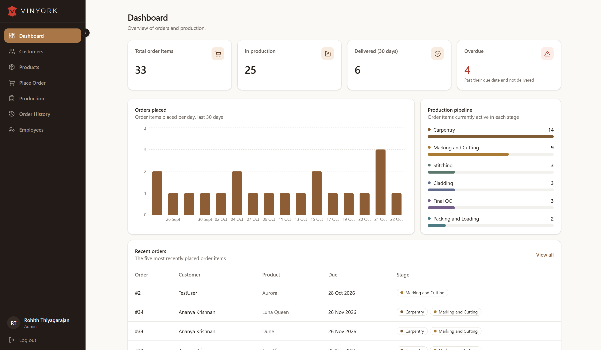
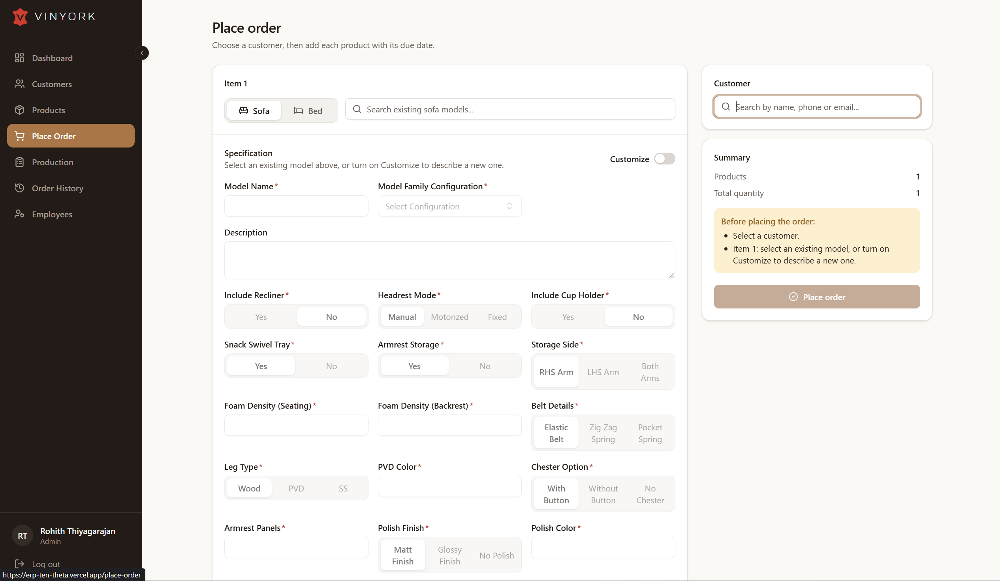
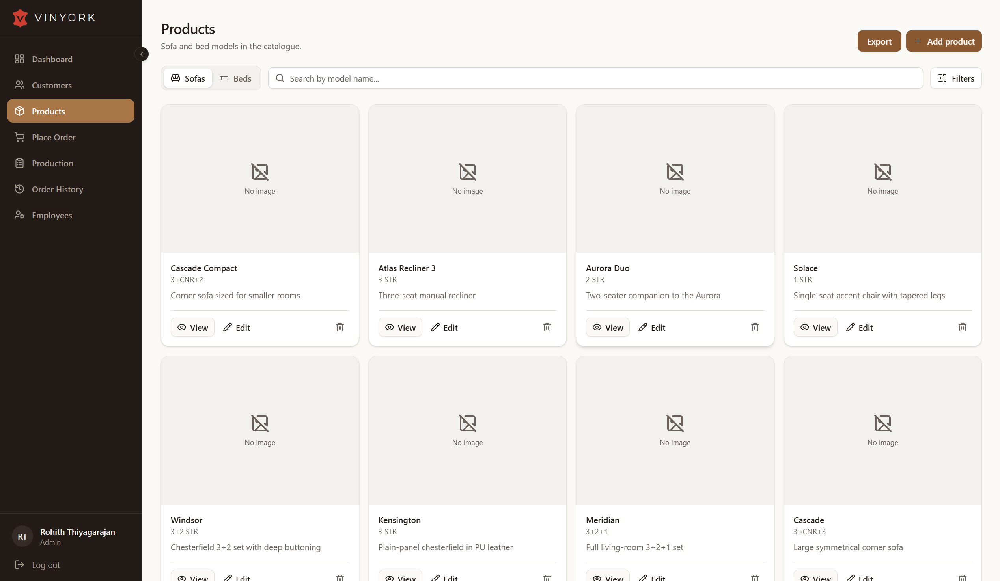
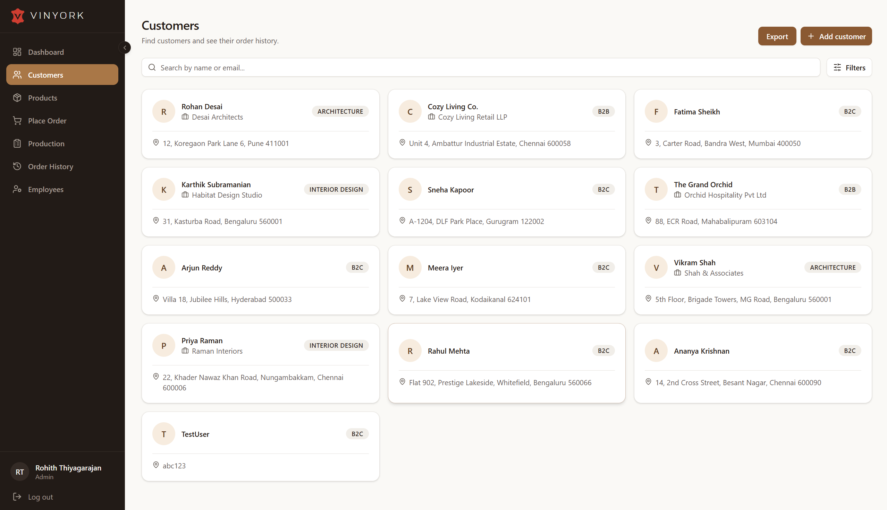
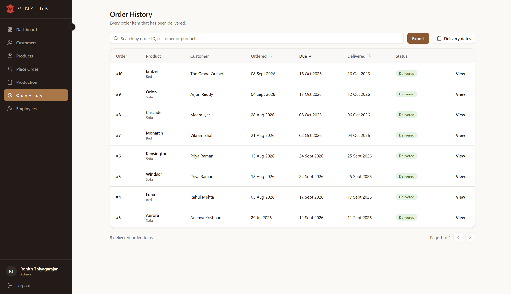

<div align="center">
  <h1>Vinyork ERP</h1>
  <p><strong>Order, production and quality tracking for a sofa and bed manufacturer.</strong></p>
  <p>
    <a href="https://erp-ten-theta.vercel.app"><strong>Live demo</strong></a>
    &nbsp;·&nbsp; click <em>Try the demo</em> on the sign-in page (read-only, sample data)
  </p>
</div>

<br />



## What it does

Every order item moves through six production stages, from carpentry to packing, and each stage has its own QC checklist that must pass before the item can move on.

- **Production tracking:** list and board views of every open item, with stage, priority and overdue filters. Each item opens a flow diagram of its stages. Stages run in parallel where the workshop allows it (carpentry alongside marking, cutting and stitching).
- **QC checklists:** pass, fail (with a written report) or skip each check; a stage completes only when every check has passed or been skipped.
- **Order entry:** pick a catalogue model or describe a fully custom sofa or bed (configuration, recliner mechanism, foam density, upholstery, legs, polish and dimensions) with reference images and measurement drawings.
- **Catalogue and customers:** sofa and bed models with images, and customer records including site measurements (door, lift and room sizes) so deliveries fit.
- **Dashboard and history:** live KPIs, a production pipeline, daily order volume and a searchable history of delivered items. Every list exports to CSV.
- **Roles:** admin, manager, production manager and sales coordinator each see only the screens they need, plus a read-only demo role.

<table>
  <tr>
    <td width="50%"><p align="center"><sub>Place order</sub></p></td>
    <td width="50%"><p align="center"><sub>Products</sub></p></td>
  </tr>
  <tr>
    <td width="50%"><p align="center"><sub>Customers</sub></p></td>
    <td width="50%"><p align="center"><sub>Order history</sub></p></td>
  </tr>
</table>

## How it's built

| Layer | Stack |
|---|---|
| App | Next.js 15 (App Router, server actions, middleware), React 19, TypeScript |
| Data and auth | Supabase: Postgres, Auth and Storage |
| UI | Tailwind CSS v4 design tokens, shadcn/ui, React Flow, Recharts |
| Validation | Zod schemas on server actions |
| Hosting | Vercel |

Highlights:

- **Security lives in the database.** Every table has row-level security, and roles are checked again inside each write function, so a hand-crafted API call gets the same answer as the UI. Only an admin can give someone a role; users can never set their own.
- **The workflow is SQL.** Order submission, check results, stage advancement and delivery are transactional `SECURITY DEFINER` functions. Stage order comes from a dependency table, so completing a stage activates every stage whose prerequisites are now done.
- **A safe public demo.** The `demo` role can open every screen, but no policy, storage rule or write function lists it. Its login is locked by a trigger, and it sees other people's emails masked.
- **One design system.** Colours are theme tokens in `app/globals.css`, and every screen shares the same page header, search, filter, table, pagination, empty-state and confirm-dialog components.
- **Business time zone.** Due dates, "overdue" and "today" use India time on both the server and the database.

## Running it locally

1. Create a Supabase project and run [`schemas/database.sql`](schemas/database.sql) in its SQL Editor. The notes at the end of the file explain how to create the first admin.
2. Optionally add the demo account ([`schemas/demo.sql`](schemas/demo.sql), "AFTER RUNNING") and sample data ([`schemas/sample-data.sql`](schemas/sample-data.sql)).
3. Copy [`.env.example`](.env.example) to `.env.local` and fill in the Supabase URL and keys.
4. Install and start:

   ```bash
   npm install
   npm run dev
   ```

5. Open http://localhost:3000 and sign in.

To deploy, import the repo into Vercel and add the same environment variables.
